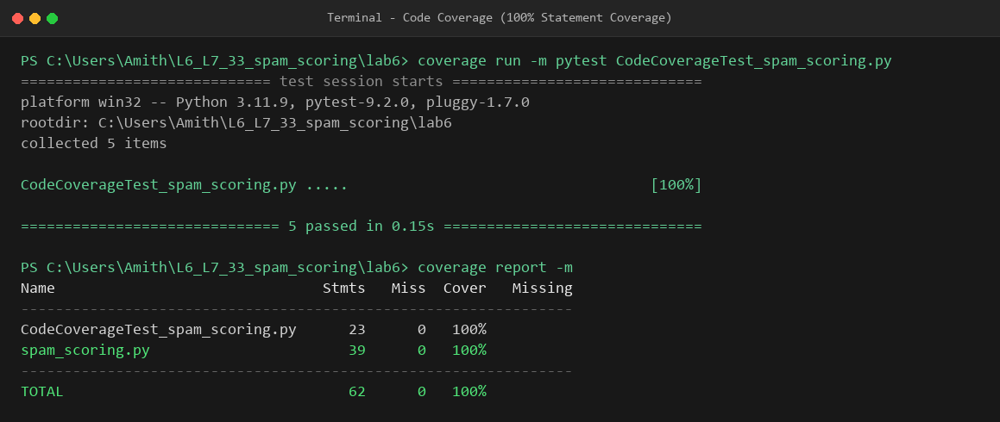
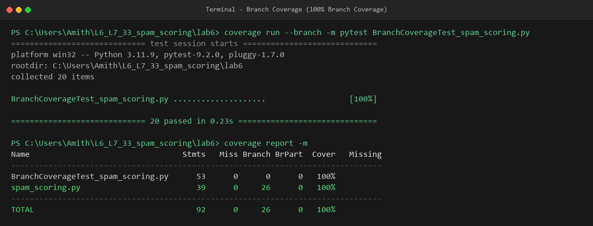

# Lab 6: Code and Branch Coverage Analysis Report

**Repository:** `L6_L7_33_spam_scoring`  
**Application Under Test:** `spam_scoring.py`  
**Author:** Amith Prasad (`prasadamith05-png`)  
**Environment:** Python 3.11.9, pytest 9.2.0, coverage 7.17.0  

---

## 1. Executive Summary

This project conducts comprehensive **Code (Statement) Coverage** and **Branch Coverage** analysis on the Spam Scoring Filter application (`spam_scoring.py`), demonstrating how code coverage and branch coverage differ in discovering untested execution paths, edge cases, and decision branches.

- **Initial State:** 41% Statement Coverage, 38% Branch Coverage
- **Code Coverage Target:** $\ge 90\%$ achieved (**100% Statement Coverage**)
- **Branch Coverage Target:** $\ge 90\%$ achieved (**100% Branch Coverage**)

---

## 2. Code Coverage vs. Branch Coverage

| Metric | Definition | Initial | Code Coverage Phase | Branch Coverage Phase |
| :--- | :--- | :---: | :---: | :---: |
| **Line / Statement Coverage** | Percentage of executable statements invoked during test execution. | 41% | **100%** | **100%** |
| **Branch Coverage** | Percentage of decision branches (evaluating boolean conditions to both `True` and `False`) exercised. | 38% | 98% (missing `17->19`) | **100%** (26/26 branches) |

### Key Difference Illustrated

Statement coverage ensures execution passes through each line of code at least once. However, as demonstrated in `score_message`:
```python
if sender_known:
    score -= 3
    if score < 0:
        score = 0
```
In initial code coverage testing, testing `HELLO` with `sender_known=True` yielded $2 - 3 = -1 < 0$, which executed line 18 (`score = 0`). Every line was executed ($100\%$ Statement Coverage), but branch coverage reported missing branch `17->19` because the alternative path (where `score >= 0` and the condition evaluates to `False`) was never taken!

Branch coverage forced the creation of test cases where `score >= 3` prior to `sender_known`, ensuring both the `True` and `False` branch paths were systematically tested.

---

## 3. Detailed Branch Analysis & Coverage Matrix

### 3.1 `score_message(text, sender_known, link_count)`
- **Loop `for word in text.split():`**
  - Iterations $= 0$: Covered by `test_empty_message_zero_links_unknown_sender` (`text = ""`).
  - Iterations $\ge 1$: Covered by all multi-word tests.
- **Decision `word.lower().strip("!.,") in SPAM_WORDS`:**
  - `True`: Covered by `test_spam_words_with_punctuation` with keywords (`winner!`, `urgent.`, `prize,`, `cash`, `free`).
  - `False`: Covered by `test_word_lowercase_not_in_spam_words`.
- **Decision `elif word.isupper() and len(word) > 3`:**
  - `True and True`: Covered by `test_word_uppercase_and_length_gt_3` (`NOTICE`).
  - `True and False`: Covered by `test_word_uppercase_but_length_le_3` (`NOW` - uppercase with length $\le 3$).
  - `False`: Covered by non-uppercase words.
- **Decision `if link_count > 3` / `elif link_count > 0`:**
  - `link_count > 3` (`True`): Covered by `test_spam_words_with_punctuation` (`link_count = 5`).
  - `0 < link_count <= 3` (`True`): Covered by `test_link_count_between_1_and_3` (`link_count = 2`).
  - `link_count <= 0` (`False` for both): Covered by `test_empty_message_zero_links_unknown_sender` (`link_count = 0`).
- **Decision `if sender_known:` and `if score < 0:`:**
  - `sender_known == False`: Covered by `test_spam_words_with_punctuation`.
  - `sender_known == True` and `score < 0`: Covered by `test_sender_known_with_score_below_3_clamped_to_zero` and `test_sender_known_with_exact_zero_score`.
  - `sender_known == True` and `score >= 0`: Covered by `test_sender_known_with_score_exceeding_3` (score $6 - 3 = 3$, branch `17->19` covered).

### 3.2 `classify(score)`
- **Decision `if score >= 8:`**
  - `True`: `test_classify_spam_at_and_above_boundary` (`score = 8, 12`).
- **Decision `if score >= 4:`**
  - `True`: `test_classify_suspicious_at_and_above_boundary` (`score = 4, 7`).
- **Fallback (`clean`):**
  - Covered by `test_classify_clean_below_suspicious` (`score = -1, 0, 3`).

### 3.3 `filter_inbox(messages)`
- **Loop `for text, known, links in messages:`**
  - Iterations $= 0$: Covered by `test_filter_empty_inbox` (`messages = []`).
  - Iterations $\ge 1$: Covered by `test_filter_inbox_with_mixed_messages` processing spam, suspicious, and clean items.

### 3.4 `inbox_status(counts)`
- **Decision `if total == 0:`**
  - `True`: Covered by `test_inbox_empty_branch` (`total = 0` $\rightarrow$ `"empty"`).
- **Decision `if ratio > 0.5:`**
  - `True`: Covered by `test_inbox_flooded_branch` (`ratio = 2/3 = 0.67` $\rightarrow$ `"flooded"`).
  - Boundary (`ratio == 0.5`): Covered by `test_inbox_boundary_ratio_exactly_half` (`ratio = 1/2 = 0.5` $\rightarrow$ `"noisy"`).
- **Decision `if ratio > 0.2:`**
  - `True`: Covered by `test_inbox_noisy_branch` (`ratio = 1/4 = 0.25` $\rightarrow$ `"noisy"`).
  - Boundary (`ratio == 0.2`): Covered by `test_inbox_boundary_ratio_exactly_twenty_percent` (`ratio = 1/5 = 0.2` $\rightarrow$ `"healthy"`).
- **Fallback (`healthy`):**
  - Covered by `test_inbox_healthy_zero_spam` (`ratio = 0.0` $\rightarrow$ `"healthy"`).

---

## 4. Test Execution & Coverage Reports

### 4.1 Code Coverage Results
```
Name                               Stmts   Miss  Cover   Missing
----------------------------------------------------------------
CodeCoverageTest_spam_scoring.py      23      0   100%
spam_scoring.py                       39      0   100%
----------------------------------------------------------------
TOTAL                                 62      0   100%
```



### 4.2 Branch Coverage Results
```
Name                                 Stmts   Miss Branch BrPart  Cover   Missing
--------------------------------------------------------------------------------
BranchCoverageTest_spam_scoring.py      53      0      0      0   100%
spam_scoring.py                         39      0     26      0   100%
--------------------------------------------------------------------------------
TOTAL                                   92      0     26      0   100%
```



---

## 5. Verification Commands

Run the following commands in the `lab6` directory to reproduce all coverage metrics:

```powershell
# Code Coverage
coverage erase
coverage run -m pytest CodeCoverageTest_spam_scoring.py
coverage report -m

# Branch Coverage
coverage erase
coverage run --branch -m pytest BranchCoverageTest_spam_scoring.py
coverage report -m
```
